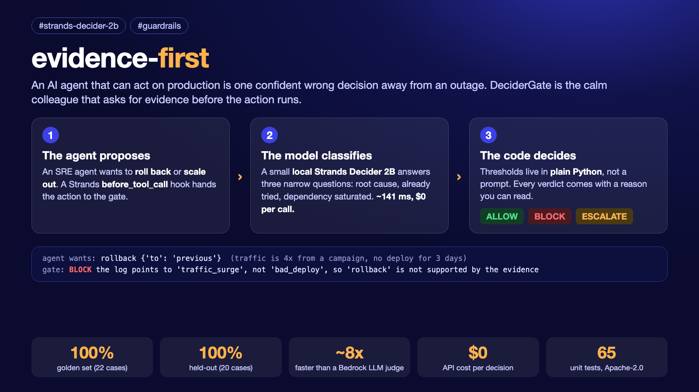

# evidence-first: DeciderGate, a reusable guardrail that reviews an agent's action before it runs

> Agent Experience Hackathon: Strands Decider · `#strands-decider-2b` `#guardrails`



An AI agent that can roll back or scale your service is one confident wrong decision away
from an outage. **DeciderGate** is the calm colleague that asks for evidence first: before
the agent acts, a small local [Strands Decider 2B](https://github.com/strands-labs/strands-decider) answers a few
narrow questions about the incident, and plain-Python policy turns those into **allow** or
**block** — with a reason you can read.

**The pattern, in one line: the model classifies, the code decides.**

```python
from rollback_gate.gate import DeciderGate

gate = DeciderGate()                       # talks to a local Decider on :8099
verdict = gate.review(incident_log, "rollback", {"to": "v41"})
if verdict.allow:
    do_rollback()
else:
    print("blocked:", verdict.reason)      # e.g. "the log points to 'traffic_surge', not
                                           #       'bad_deploy', so 'rollback' is not supported"
```

The Decider never picks the action. It answers three typed questions — *what is the root
cause*, *was this action already tried*, *is a dependency saturated* — and a `Policy` whose
thresholds live in code decides. That means you tune the guardrail by editing a few lines
and re-running a golden set, not by swapping in a bigger model.

## Architecture


The editable source is `docs/architecture.pptx` (spec: `docs/architecture_spec.json`).

## Why a gate instead of just asking a big LLM?

Same 22-incident golden set, judged two ways — our gate (local Decider) vs. a general
Bedrock LLM deciding directly:

| | DeciderGate (local) | Bedrock Haiku 4.5 |
|---|---|---|
| accuracy | 100% | 100% |
| latency (median) | ~141 ms | ~1091 ms |
| API cost / 22 cases | $0 | ~$0.010 |

Same correctness, ~8× faster, nothing billed per call. And it reached 100% the honest way:
the first version missed cases on the golden set and later on a held-out set, and each was
fixed by **naming a missing pattern in one narrow question and adding cases** — not a
larger model. Golden 100% (22 cases), held-out 100% (20 never-seen cases). The full
before→after and the two tuning passes are in [`PATTERN_NOTES.md`](PATTERN_NOTES.md).
(Bedrock latency is over the public endpoint and varies by network; Haiku 4.5 priced $1/$5
per 1M tokens, us-east-1, 2026-10.)

**Demo video.** The submission video is a rendered replay of the *real* output of `demo.py` and `analysis.py sweep` (plus the measured numbers in `bench_compare.json`); nothing is staged or hand-typed. Regenerate it with `python record/make_video.py`.

## What's reusable here

- **`rollback_gate/gate.py`** — the `DeciderGate` pattern: typed questions + a `Policy` of
  thresholds + a pure `judge()` function. Supports a three-way verdict (allow / block /
  **escalate** to a human on borderline cause) and a risk-aware bar (a high blast-radius
  action, scored by the Decider, needs a stronger cause). Swap the questions and the
  `JUSTIFYING_CAUSE` map and the same shape gates any risky action.
- **`rollback_gate/temporal.py`** — an opt-in, AgentCore-style temporal policy: limits that
  span actions (rate limit per window, running-total count, and a cumulative-impact cost
  cap), checked in code before the model is asked. Catches thrashing a single-action judge
  can't see. Fully additive — a gate with no temporal policy behaves exactly as before.
- **`rollback_gate/audit.py`** — an append-only JSONL audit log (every decision, with the
  incident hashed not stored, plus the policy version) and an idempotency cache that dedupes
  identical reviews within a TTL (skips the model, prevents double execution).
- **`rollback_gate/observability.py`** — one OpenTelemetry span per decision (CNCF-standard;
  what CloudWatch speaks natively), drop-in to the gate's audit slot.
- **`rollback_gate/client.py`** — a dependency-free client for a Decider server (`urllib`
  only), so you can drop it into a project without taking on anything but `strands-agents`.
- **`rollback_gate/golden.py`** — a labelled golden set you tune the policy against.
- **`agent.py`** — the same gate wired into a Strands agent at `before_tool_call`: a
  blocked action returns `Guide(reason)`, so the agent reconsiders instead of acting on a
  wrong instinct. It runs with the temporal policy and audit log attached, so a thrashing
  agent is throttled and every decision is recorded.
- **`rollback_gate/advisor.py`** — turns the gate around: instead of reviewing one proposed
  action, it asks the Decider to *rank* the candidate remediations and then confirms each,
  best first, through the gate — returning the first the evidence actually supports, or
  escalating if none do. The model proposes a shortlist; the code decides which survives.

## Run it

```bash
# 1. a local Decider model (the hackathon's 2B decision model)
strands-decider serve StrandsAgents/strands-decider-2B-qwen3.5-v1-2610 --port 8099

# 2. the four-scene demo (allow once, block three times, each with a reason)
python demo.py --slow

# 3. the gate as a real Strands agent (needs AWS creds for Bedrock to drive the agent)
AWS_PROFILE=<profile> python agent.py     # eager SRE agent; gate guides a wrong rollback back

# 4. tests — 65, with the model, Bedrock, Strands and OTel mocked/in-memory, no network
python -m pytest tests/ -q

# 5. the head-to-head benchmark, and the held-out validation set
python bench_compare.py --gate            # local Decider only (no AWS)
AWS_PROFILE=<profile> python bench_compare.py       # vs. Bedrock Haiku (golden set)
python bench_compare.py --gate --set=holdout        # generalisation check (100%, 20 cases)

# 6. evidence for the writeup (confusion matrix, counterfactual, cost by volume, sweep)
python analysis.py all                    # reads the bench JSON; no model
python analysis.py sweep                  # accuracy vs threshold (needs the local server)
```

## Layout

```
rollback_gate/
  gate.py        the reusable DeciderGate pattern (questions + Policy + 3-way judge)
  client.py      tiny urllib client for the Decider server
  baseline.py    a Bedrock LLM judge — comparison baseline only, not used at runtime
  golden.py      22 labelled incident/action cases (used to tune the policy)
  holdout.py     20 held-out cases (never tuned on; generalisation check, 100%)
  temporal.py    session-aware temporal policy (rate / count / cost; AgentCore-style)
  audit.py       JSONL audit log + idempotency cache (both opt-in)
  observability.py  one OpenTelemetry span per decision (opt-in)
  advisor.py     ranks candidate actions via the Decider, confirms each through the gate
tests/           65 unit tests (model, Bedrock, Strands & OTel mocked/in-memory)
agent.py         the gate wired into a Strands agent (temporal policy + audit attached)
demo.py          five-scene narrated demo (incl. the temporal policy)
bench_compare.py DeciderGate vs Bedrock on golden/holdout (accuracy/latency/cost)
analysis.py      confusion matrix · counterfactual · cost extrapolation · threshold sweep
PATTERN_NOTES.md the tuning passes + held-out validation, with numbers
DEMO_SCRIPT.md   < 3-min video script
ENHANCEMENTS_MENU.md  the full menu of possible enhancements
record/          recording env, pre-record sanity check, safe-for-Public guide
docs/            architecture diagram (spec + PPTX)
```

Apache-2.0 (see `LICENSE`; `rollback_gate/client.py` is adapted from the upstream strands-decider example, see `NOTICE`).
Built for the Strands Decider hackathon; the gate pattern is meant to be lifted into your own agent.

**Scope note.** Strands Decider 2B is experimental, and so is this gate: the golden (22) and held-out (20) sets are small,
synthetic and written by the author, so "held-out" means *not tuned on*, not *independent*. Re-tune the thresholds on your own incidents.
